<!-- ========================================================================= -->
<!--                   SUDEEP NELLAPPA - GITHUB PROFILE README                -->
<!--       Cloud & DevOps Engineer | AWS Security Architect | Full Stack | AI  -->
<!-- ========================================================================= -->

<!-- Dual Dynamic Theme Banners: Dark & Light Mode Toggle -->
<picture>
  <source media="(prefers-color-scheme: dark)" srcset="assets/banner-dark.svg">
  <source media="(prefers-color-scheme: light)" srcset="assets/banner-light.svg">
  
</picture>

  

<!-- Dynamic Animated Role Typewriter in Dual Color for Dark/Light Themes -->
<picture>
  <source media="(prefers-color-scheme: dark)" srcset="https://readme-typing-svg.demolab.com?font=Fira+Code&weight=600&size=20&duration=3000&pause=1000&color=00F2FE&center=true&vCenter=true&width=750&height=50&lines=Cloud+and+DevOps+Engineer;AWS+Cloud+Security+Architect;Full+Stack+Web+Developer;CI+CD+and+Multi-Platform+Deployment;Local+AI+Model+Inference+(Ollama+%7C+Hugging+Face)">
  <source media="(prefers-color-scheme: light)" srcset="https://readme-typing-svg.demolab.com?font=Fira+Code&weight=600&size=20&duration=3000&pause=1000&color=0369a1&center=true&vCenter=true&width=750&height=50&lines=Cloud+and+DevOps+Engineer;AWS+Cloud+Security+Architect;Full+Stack+Web+Developer;CI+CD+and+Multi-Platform+Deployment;Local+AI+Model+Inference+(Ollama+%7C+Hugging+Face)">
  
</picture>

  

<!-- Status Badges -->

&nbsp;

&nbsp;

  

&nbsp;

&nbsp;

 

 

## ⚡ Executive Briefing & About Me

  <picture>
    <source media="(prefers-color-scheme: dark)" srcset="assets/01-about-dark.svg">
    <source media="(prefers-color-scheme: light)" srcset="assets/01-about-light.svg">
    
  </picture>

 

 

## ⚡ Core Engineering Pillars

  <picture>
    <source media="(prefers-color-scheme: dark)" srcset="assets/02-pillars-dark.svg">
    <source media="(prefers-color-scheme: light)" srcset="assets/02-pillars-light.svg">
    
  </picture>

 

 

## 🛡️ Featured Engineering Project: AWS CloudShield

  <picture>
    <source media="(prefers-color-scheme: dark)" srcset="assets/03-cloudshield-dark.svg">
    <source media="(prefers-color-scheme: light)" srcset="assets/03-cloudshield-light.svg">
    
  </picture>

 

 

## 🏆 Credentials & Education

|  **Master of Computer Applications (MCA)** Karnatak University, Dharwad |  **Bachelor of Computer Applications (BCA)** JSS SMI UG & PG Studies, Dharwad |
| :---: | :---: |
|  **Google Cybersecurity Specialization** Coursera Certified Professional |  **Google AI Essentials** Foundational AI & Prompt Engineering |
|  **AWS Training Certificate** Core Cloud Services & Architecture |  **Full Stack Training Certificate** Full Stack PHP, MySQL, Bootstrap |

 

 

## 📈 Real-Time GitHub Telemetry & Stats

  <picture>
    <source media="(prefers-color-scheme: dark)" srcset="assets/04-stats-dark.svg">
    <source media="(prefers-color-scheme: light)" srcset="assets/04-stats-light.svg">
    
  </picture>

 

 

## 🏎️ Live Contribution Activity Grid

  <picture>
    <source media="(prefers-color-scheme: dark)" srcset="assets/05-f1-grid-dark.svg">
    <source media="(prefers-color-scheme: light)" srcset="assets/05-f1-grid-light.svg">
    
  </picture>

 

 

## 🤝 Let's Connect & Collaborate!

  <picture>
    <source media="(prefers-color-scheme: dark)" srcset="assets/06-connect-dark.svg">
    <source media="(prefers-color-scheme: light)" srcset="assets/06-connect-light.svg">
    
  </picture>

    

  

    
    &nbsp;
    
  

 

<!-- Matching Sleek Cyber Footer Wave -->

  

