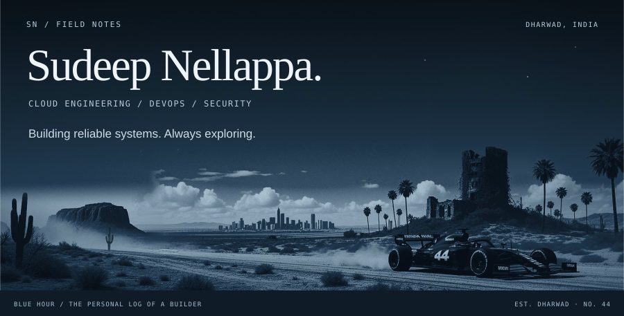
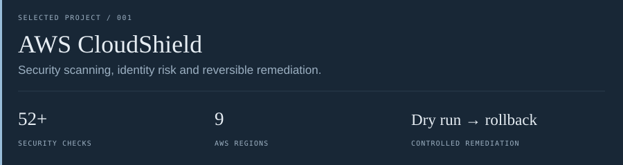
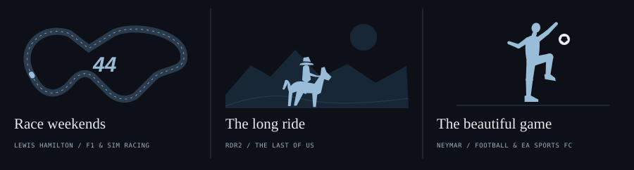
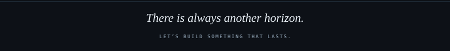

<!-- Blue Hour — Sudeep Nellappa. Self-contained SVGs; light and dark share one palette. -->

  <a href="mailto:sudeepn1011@gmail.com">EMAIL</a> &nbsp; / &nbsp;
  <a href="https://github.com/NSudeep-Rust?tab=repositories">PROJECTS</a> &nbsp; / &nbsp;
  <a href="https://github.com/NSudeep-Rust/AWS-Cloud-Control-Panel">CLOUDSHIELD</a>

## 01 / A little about me

I'm **Sudeep**, a Cloud & DevOps engineer and full-stack developer based in **Dharwad, India**. I work on AWS security, automated delivery, and privacy-first local AI, and I'm currently pursuing my **MCA at Karnatak University**.

I like understanding how systems fit together, making them more reliable, and building tools people can actually use. Currently open to **full-time and remote roles** in cloud, DevOps, security, and full-stack engineering.

**Cloud & security** · AWS, EC2, S3, IAM, VPC, KMS  
**Delivery & systems** · GitHub Actions, Linux, Bash, Git  
**Web & applications** · Python, FastAPI, React, PHP, MySQL  
**Local AI** · Ollama, Hugging Face, Transformers

## 02 / Built with purpose

<a href="https://github.com/NSudeep-Rust/AWS-Cloud-Control-Panel">
<picture>
  <source media="(prefers-color-scheme: dark)" srcset="assets/midnight/cloudshield-dark.svg">
  <source media="(prefers-color-scheme: light)" srcset="assets/midnight/cloudshield-light.svg">
  
</picture>
</a>

My MCA project brings **52+ security checks across 9 AWS regions**, IAM risk analysis, live threat monitoring, and reversible remediation into one desktop application. Built with Python, FastAPI, React, and Electron.

[Explore the project →](https://github.com/NSudeep-Rust/AWS-Cloud-Control-Panel)

**Learning & credentials** &nbsp; MCA, Karnatak University · BCA, JSS SMI, Dharwad  
Google Cybersecurity Specialization · Google AI Essentials · AWS training · Full-stack training, Pravinya InfoTech

## 03 / One commit at a time

<picture>
  <source media="(prefers-color-scheme: dark)" srcset="https://raw.githubusercontent.com/NSudeep-Rust/NSudeep-Rust/output/github-contribution-grid-snake-dark.svg">
  <source media="(prefers-color-scheme: light)" srcset="https://raw.githubusercontent.com/NSudeep-Rust/NSudeep-Rust/output/github-contribution-grid-snake.svg">
  
</picture>

Small steps, real work. <a href="https://github.com/NSudeep-Rust?tab=overview">View my GitHub activity →</a>

## 04 / Away from the terminal

<picture>
  <source media="(prefers-color-scheme: dark)" srcset="assets/midnight/interests-dark.svg">
  <source media="(prefers-color-scheme: light)" srcset="assets/midnight/interests-light.svg">
  
</picture>

Race weekends with **Lewis Hamilton**, a long ride through **RDR2**, or **Neymar** doing Neymar things. Also into The Last of Us, sim racing, and EA Sports FC.

Cloud infrastructure, open-source tools, or a good project idea? <a href="mailto:sudeepn1011@gmail.com"><strong>Let’s talk → sudeepn1011@gmail.com</strong></a>

<picture>
  <source media="(prefers-color-scheme: dark)" srcset="assets/midnight/footer-dark.svg">
  <source media="(prefers-color-scheme: light)" srcset="assets/midnight/footer-light.svg">
  
</picture>
